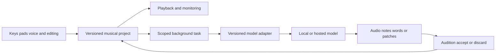

# OmniuSong product specification

October 20 production architecture amendment: the [complete release goal](GOAL.md) requires Rust throughout the native Mac/Windows application, including UI, audio, storage, MIDI, jobs, adapters and plugin hosting. MIDI 2.0 and MPE are mandatory end-to-end capabilities with independent acceptance. The web/Swift/Python paths described below are prototype/reference work. See the [adopted Rust architecture](RUST-ARCHITECTURE.md), [migration sequence](RUST-MIGRATION.md) and [release acceptance matrix](RELEASE-ACCEPTANCE.md) for current implementation decisions and evidence gates.

Version 0.1 · October 15, 2026 · Mac first, Windows second

## The music experience

A musician plays an eight-bar piano phrase, sings a rough chorus, and taps a beat. OmniuSong keeps those original performances. A co-producer suggests three bass parts, builds a new glass-like instrument, and proposes a choir arrangement from the singer's melody. The musician auditions each suggestion against the song, changes individual notes, locks the chorus, and accepts only the material that belongs.

OmniuSong is a digital audio workstation with an AI model and workflow layer. Its defining property is that sound generation, symbolic composition, instrument building, recording, and arrangement share one editable project. The musician can always move between playing, listening, editing, and asking for help.

The initial audience is one musician and their collaborators. A private, local studio comes first. Model and plugin breadth should remain possible without requiring public multi-tenant infrastructure.

## Product commitments

- Human performances remain available in their original form. Edits and generated alternatives are versions or derived assets.
- Every AI operation has an explicit musical scope: selected notes, a clip, a phrase, a stem, a section, or a whole arrangement.
- Suggestions are candidates with audition, accept, and discard controls. Background generation cannot silently rewrite a performance.
- Locked tracks, notes, sections, lyrics, and voice identity remain protected through all operations.
- Playing and monitoring continue while models load or generate. Model work never runs in the realtime audio callback.
- Model choice, input routing, execution location, resource use, and the difference between procedural and AI tools are visible.
- Music remains editable and exportable through documented project, audio, and musical-event formats.

## Primary workspaces

### Studio

The main screen combines a transport, arrangement, selected clip editor, performance pads, keyboard, and a compact co-producer panel. Track colors and instrument roles stay consistent across views. The interface should feel like an instrument: the next action is usually play, record, edit, audition, or accept.

Clips can contain audio, notes, automation, or a reference to a model's musical plan. Scenes let the musician launch combinations of clips on bar boundaries. The arrangement captures a scene performance as an editable timeline. The preview transport loops the project bar span, while the initial piano-roll editor shows the first four bars. Full timeline navigation, scene launch, and song sections are later milestones.

### Songbook

Lyrics use named song sections, line alternatives, syllable targets, optional pronunciation, and alignment to musical phrases. The user can select a line and request variations while locking the rest. A language model drafts words; a singing model performs a score. Neither capability implies the other.

### Instrument lab

A musician describes or demonstrates a sound, compares samples or neural timbres, and builds a playable patch. The patch retains generation settings, source audio, note roots, velocity layers, envelopes, loop points, round robins, and expression mappings. A single generated audio file becomes an instrument only after this mapping and audition step.

The lab supports ordinary synthesis and sample playback alongside neural instruments. A custom FM patch or sample instrument should be a useful musical result even when no model is available.

### Model observatory

Each model card shows its musical role, supported controls, outputs, runtime location, memory estimate, license source, integration state, and listening results. Users can Keep, Explore, or Skip candidates. Research recommendations are separate from installation, runtime qualification, and musical acceptance.

Model versions and adapters have separate identities. Updating an adapter must not silently change the checkpoint used by an existing project.

### Performance surface

Pads select drums, trigger slices or clips, and launch scenes. Keys play the selected instrument. Knobs map to conventional parameters, high-level musical controls, or weighted generation prompts. A footswitch can capture an idea, stop a take, or cycle a candidate without taking hands off the instrument.

The first hardware profile is a Mac with any compatible USB MIDI keyboard and pad controller, plus a microphone or audio interface. Akai-style pads are an interaction reference. The workstation must work with ordinary MIDI 1 controllers while retaining richer expression from MIDI 2 and MPE equipment.

## Creative workflows

| Workflow | Human action | AI or processing role | Editable result |
| --- | --- | --- | --- |
| Sing a melody into an instrument | Sing a phrase, choose a root and timing | Transcribe pitch and bends; propose quantization | Notes, original audio, estimated curves, confidence |
| Build a chorus from your voice | Record a lead and choose harmony constraints | Infer or accept chords, write harmony parts, synthesize or convert performances | Separate lead and harmony tracks with per-part scores |
| Play with an AI pianist | Play a phrase and mark a handoff | Continue symbolic piano with Aria or another adapter | Notes and expressive timing, accepted phrase by phrase |
| Sketch a complete song | Supply lyrics, structure, style, and optional references | MiniMax Music 3, ACE-Step, or another generator | Full audio, metadata, and any genuine separate outputs |
| Re-score a song | Edit melody or chords and select a target sound | A score-conditioned model such as MuLaCover or YuE2 | New audio version linked to the human-edited score |
| Make an impossible instrument | Describe a hybrid timbre and play a test phrase | Generate samples or explore a neural latent space | Playable patch, mappings, samples, and expression controls |
| Perform a changing accompaniment | Play or turn musical controls | A qualified local or streaming realtime model | A recorded performance plus steering automation |
| Recover editable material | Import authorized audio and select parts | Separate sources, then transcribe appropriate stems | Original mix, estimated stems, note tracks, review markers |

Generated stereo audio does not become isolated stems, a score, or a faithful reconstruction automatically. Each conversion is a separate operation with its own provenance and quality review.

## The choir pipeline

The intended choir flow is explicit: capture the original lead; establish tempo and phrase boundaries; transcribe melody and words; review a lead sheet; write harmony voices under chord, range, spacing, and syllable constraints; render each voice; align consonants and breaths; mix the section.

The user controls the number of singers, register, vowel shape, timing spread, pitch spread, stereo placement, dynamics, and the amount of the original singer's identity used. A small intimate double and a large synthetic choir should be distinct presets over editable parts.

DiffSinger is a candidate for score-driven voices. Voice conversion is a separate optional stage for an authorized voice. Copying a recording with pitch-shifted playback is a useful effect, but it is not presented as independently performed harmony. Original takes and rendered voices remain separate assets.

## Model and plugin substrate

OmniuSong has several kinds of extension with different runtime needs:

| Extension | Responsibility | Runtime boundary |
| --- | --- | --- |
| Model adapter | Translate an OmniuSong task to a versioned inference interface | Background worker or hosted request |
| Workflow pack | Compose typed operations, transformations, and review steps | Durable job graph |
| Instrument or effect | Generate or process audio under a bounded audio contract | Native audio engine and isolated plugin host where feasible |
| Timbre pack or LoRA | Extend a compatible model with named weights and settings | Qualified model-specific loader |
| Sample or voice pack | Supply audio, mappings, pronunciations, and usage metadata | Asset store and instrument engine |
| Controller map | Translate input events and gestures into musical actions | Native input layer |

A "mod" must declare which kind it is. A LoRA for one architecture is not assumed to work in another. An audio plugin is not loaded through the same unrestricted execution path as a workflow pack.

The manifest declares API version, identity, version, capabilities, input and output schemas, runtime, model references, permissions, parameter controls, and compatibility. Production installation will verify package identity and display changes in permissions. The first registry is an in-process developer API with trusted built-ins; it is not a secure sandbox for arbitrary downloaded code.

Capabilities include lyric drafting, lyric revision, transcription, separation, score continuation, accompaniment, song generation, audio inpainting, sample creation, neural instrument rendering, singing synthesis, voice conversion, retrieval, analysis, and export.

Each adapter advertises the controls it actually supports. Tempo and key prompts are distinct from hard constraints. A control is labeled exact, conditioning, advisory, or unsupported. The system cannot promise an exact melody lock from an adapter that only accepts descriptive text.

## Project data

The durable project owns tracks, clips, notes, automation, sections, lyrics, patches, asset references, job references, accepted candidates, and musical decisions. Each persisted object has a stable ID and a schema version. Musical event time uses integer ticks at 960 PPQ in the first format. Audio timing uses sample positions and a tempo map in the production format.

Notes retain 16-bit attack velocity, duration, pitch, channel and group addressing where applicable, release velocity, per-note expression, and the source measurement. Transcription confidence and estimated curves remain distinguishable from measured controller gestures. Scaling a low-resolution value to 16 or 32 bits does not create new performance information.

Audio assets are content-addressed. Asset records include sample rate, channels, duration, originating task, source references, and the relationship to original recordings. Production projects use a portable archive containing project data, required assets, checksums, and a manifest. External model weights remain references rather than bundled copies by default.

The preview implements `.omniusong` backups as versioned gzip JSON bundles with checksummed audio. Restoring creates a new project identity and retains the original session. Saved-session selection flushes pending edits before switching. [Archive format](PROJECT-ARCHIVE.md).

The initial schema implements integer note timing, 16-bit attack/release velocity, source/group/channel metadata, internal voice identities, bounded raw input capture, expression lanes, locks, immutable audio IDs, revision checks, and accepted-candidate provenance. Complete archives include checksummed asset manifests. Tempo maps, clock calibration, detailed expression editing, and native MIDI 2 end-to-end acceptance remain separate work.

## AI task lifecycle

The project owns the music. Models produce reviewable material through adapters; playback reads the accepted musical state.

A task records the project revision, selected musical scope, model identity, adapter version, parameters, inputs, seed where meaningful, resource limits, and expected outputs. State progresses through queued, running, succeeded, failed, canceled, or interrupted. Candidate review is a separate pending, accepted, or rejected decision.

An adapter may return audio, notes, lyrics, patches, stems, analysis, or a musical plan. OmniuSong validates outputs before offering them for audition. Acceptance uses a project transaction and a provenance record. A changed project produces a conflict that the user can resolve; the initial build asks for a fresh candidate rather than applying a stale lyric replacement.

Cancellation stops the local request or signals the worker. Hosted jobs that cannot be canceled report that limitation and suppress unaccepted output. Restart recovery never blindly resubmits a paid task. A service timeout and a rejected candidate are different outcomes.

The first queue has one local worker and a five-minute job limit. Production scheduling will separate interactive tasks, offline rendering, and batch generation, with GPU admission and a bounded spending policy for each provider.

## Audio and MIDI architecture

The production target uses a native realtime audio engine with sample-accurate scheduling, bounded work, audio device selection, latency reporting, recording compensation, and crash recovery. A portable control layer owns projects and background jobs. Mac input and device support use CoreAudio and CoreMIDI. Windows will use a qualified audio backend and Windows MIDI Services where available, with an explicit fallback.

The first runnable vertical slice uses Web Audio for playback and a native WebKit shell for CoreMIDI input. This establishes musical editing and adapter contracts quickly. It is not the final low-latency engine. Keep the project and adapter contracts portable so replacing playback does not require replacing saved music.

MIDI 2 support is staged: expressive project representation, UMP encoding and decoding, native transport, device discovery, MIDI-CI and profiles, then standard Clip File interchange and device-specific acceptance. MIDI 1 file export remains valuable for existing software and has explicit expression-loss reporting.

Audio plugin hosting begins with Audio Units on Mac, then VST3 and CLAP where requirements justify the work. Inspect current SDK licenses at implementation time. Compare an isolated custom host with established frameworks before committing. Carla is a useful reference and external bridge candidate, with its own GPL terms; it is not embedded by default.

## Human control and interaction

Record, stop, undo, all-notes-off, mute, solo, and monitoring must be immediate. The system exposes armed tracks and input sources clearly. A generated variation has a visible scope, model, cost estimate where applicable, and musical relationship to the original.

The co-producer can explain a musical suggestion, offer alternatives, or propose a workflow. It cannot send messages, publish songs, upload a personal recording, train a voice, or spend money simply because those actions might help a task. Those are explicit operations with visible destinations and project policy.

Voice commands and singing are separate input modes. A sung phrase becomes a recording; a spoken instruction becomes a reviewable action request. Headphone monitoring and clear capture indicators prevent accidental feedback and make the source of sound understandable.

## Performance targets

These are acceptance targets, not measured results for the current preview.

| Area | Initial production target | Measurement |
| --- | --- | --- |
| Live note response | Under 10 ms software path on the qualified Mac rig | Timestamped input to rendered-buffer event; hardware loopback reported separately |
| Recording stability | 30 minutes without dropouts at the selected device configuration | Input/output loopback and recorded sample continuity |
| Background generation | No additional audio callback dropouts under a bounded model workload | Baseline and load comparison with device and buffer settings |
| Undo | Every destructive musical edit and candidate acceptance reverses | Transaction and audible round-trip checks |
| Save recovery | Survive process termination during save without corrupting the last committed project | Fault injection and reopened asset validation |
| MIDI 2 integrity | Preserve raw resolution, timing, and per-note identity through supported operations | Packet fixtures, virtual loopback, and two independent device implementations |
| Model quality | Shortlisted adapters pass a shared listening and controllability rubric | Blind A/B sessions with identical briefs and recorded judgments |

## Delivery boundaries and decisions

The platform name is OmniuSong for this project. The interaction style is an MPC-like music workspace with keys, pads, microphone, and human direction. The first build is local and single-user. No hardware purchase or paid provider is required to review it.

Mac architecture, adapter contracts, and editable musical data come before public hosting. Actual hardware inventory, preferred audio interface, desired singing identity, provider budgets, and distribution licensing remain user decisions. Development can progress with documented defaults while those choices stay open.

The roadmap and implementation plan define the sequence, acceptance gates, and current work. The desired result is a complete creative instrument; an overnight development slice is the beginning of that implementation.
