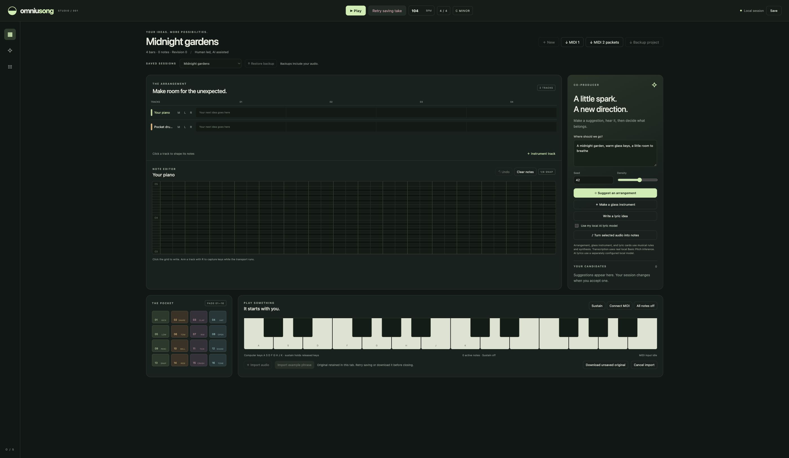

# Recording and original audio

The preview keeps the human source separate from estimated notes. Recording and import send audio only to the studio's loopback service. No cloud audio service is enabled.

## Record a take

Choose **Record voice** to request the microphone. Permission is requested only on that action. While the request is pending, **Cancel mic request** cancels the application's request; if the browser supplies a stream afterward, its tracks are stopped. This does not change the browser's saved permission setting.

**Finish take** stops capture, waits for final encoded audio, releases the microphone, stores the original asset, attaches it to the current session, and saves that session. Session switching and restoration stay blocked through the permission, recording, finalization, and save stages. The preview stops recording after two minutes or when its encoded-byte limit is reached. Timer timing and media encoding are browser controlled; this is not sample-accurate recording alignment.

If storage fails, **Retry saving take** retries the same original and track identity. **Download unsaved original** gives you the original bytes independently. Unsaved recovery stays in this tab's memory until saving or download; it is not durable against a browser crash. Closing the tab while recovery is pending triggers the browser's leave-page prompt. Original recovery does not silently discard a microphone take.

A device interruption saves the bytes the recorder produces and records an interruption message. An interrupted container may still need repair or may be unplayable; preserved bytes are not a guarantee of a complete performance.

## Import audio

Choose **Import audio**, then select a WAV, MP3, M4A/MP4, FLAC, Ogg, or WebM file. Imports are limited to 30 MiB and two minutes. The browser must report a readable duration and decode the audio. Support varies with browser, container, and codec. An unfinalized WebM file may lack a finite duration and be rejected; recording within the studio does not require that import metadata path.

The original is stored unchanged under its content checksum. Its filename, MIME type, duration, byte length, and import origin remain in the project and its backup. Decoding for validation does not replace the stored original. Audio tracks have a full-take player and **Download original**. Arrangement playback honors optional `audio.startTick` placement and can cut audio at the loop boundary. Existing microphone/import takes default to the loop start. Magenta candidates can choose a placement bar. Select any audio track to edit its exact start and source in/out points, audition that window, or restore original clip settings after reload. Full-file players and downloads keep the complete source. Transcription analyzes the selected window at the clip's saved position and records its decoded frame bounds. Accepted note tracks remain independent of later audio edits. See [clip editing](CLIP-EDITING.md).

If an import fails, retry it, download its retained bytes, or use **Cancel import**. Canceling an import does not delete the source file. If an asset was already written, it remains in the local content store; automatic orphan cleanup is not implemented.

**Import example phrase** loads a procedural four-tone WAV through the same import and saving pipeline. It is synthesized test material, not a human recording or an AI-generated song. Select that audio track and choose **Turn selected audio into notes** to run actual local Basic Pitch inference. Audition and acceptance keep its original audio intact.

## Observed verification

- The browser imported the 3.2-second example, ran Basic Pitch, auditioned and accepted four pitches, and reloaded the saved session. Its complete archive restored into an empty store with both original and analysis audio intact. See `verification/audio-import.json`.
- A separate temporary local service deliberately failed one audio write. The UI retained the original, blocked session changes, downloaded byte-identical audio, and retried without adding a duplicate track. The temporary service was stopped. See `verification/audio-recovery.json`.
- Audio HTTP responses provide byte lengths and byte-range seeking. The browser's original player reported 3.2 seconds after the fix. Automated checks cover full, prefix, suffix, and open-ended ranges and invalid requests.
- Recorder tests use fake streams to exercise pending permission, cancellation, denial, interruption, final events, save failure, retry, and stale timers. They do not establish microphone hardware operation.

WAV decoding is qualified in this browser flow. Other listed containers have storage paths, with MP3/FLAC byte-preservation tests; their actual codec playback and human-recording quality are pending. External file selection in automated Chrome control remains blocked by the extension's file URL permission. No browser permissions were changed to work around it. The generated example avoids that selection step while exercising the real application import path.

