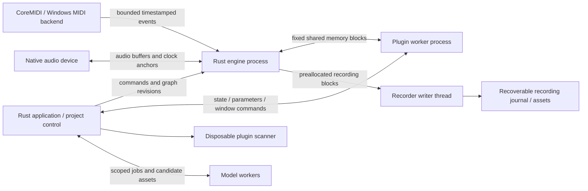

# Rust audio, expressive MIDI, and plugin hosting

Research date: 2026-10-20. Status: architecture recommendation, not implementation or hardware qualification. Scope: the Rust application/engine migration, Mac first and Windows second. This document does not change the existing project, saved performances, or runtime.

## Recommendation

Build a Rust engine with an explicit render contract and independent platform adapters. Use native CoreAudio and CoreMIDI on Mac. Use event-driven WASAPI with explicit shared/exclusive configuration on Windows, qualifying the actual device/driver combination; make ASIO an optional, separately licensed backend. Implement AU hosting first on Mac, followed by CLAP and VST3 on both platforms. Keep scanners and third-party plugin execution outside the engine process.

Use Rust bindings to native APIs rather than making a C++ host framework the owner of the engine. The preferred building blocks are `objc2-core-audio`/`objc2-audio-toolbox`/`objc2-core-midi`, `midi2`, `clack-host`, `vst3`, and a small Windows adapter over `wasapi`/`windows`. These are components, not a ready-made DAW. Their limits and proposed qualification gates appear below.

Make five distinct contracts: editable expression in projects; lossless raw event capture; native UMP/MIDI transport; MIDI-CI discovery/configuration; and standard MIDI Clip File interchange. Support full MPE as an expressive MIDI 1 path alongside MIDI 2. Neither a UMP input port nor a plugin-format label demonstrates that an instrument performs all the recorded gestures.

The product targets remain **under 10 ms from timestamped input to rendered-buffer event on a qualified Mac configuration**, and **30 minutes of recording without dropouts**. No latency, physical MIDI, audio-device, or third-party plugin acceptance measurement was performed for this research.

## What is already present

The following observations come from the current checkout, not from earlier completion reports:

| Existing source | Observed behavior | Migration consequence |
| --- | --- | --- |
| `native/Sources/OmniuSongMac/main.swift`, `native/Package.swift` | A macOS 13+ AppKit/WebKit shell requests a MIDI 2 CoreMIDI input port. It copies packet words, preserves host ticks as decimal strings, then dispatches JSON to JavaScript on the main thread. | Retain source identity and raw words. Replace the UI delivery path for musical scheduling. This is not a native audio engine or native MIDI-output host. |
| `public/audio.js`, `public/transport.js` | Web Audio instruments, clip playback, metronome/count-in, and a JavaScript scheduling loop. Recorded expression lanes are not performed. | Reproduce musical behavior and audition isolation in the Rust graph, then verify native timing. |
| `src/project.mjs` | Schema 1, PPQ 960, integer ticks, attack/release velocity up to 65535, UUID-like note IDs, source/group/channel, key duration, and pitch/pressure/timbre lanes with unsigned 32-bit values. | Preserve existing values exactly. Add units, expression scope, clock links, and richer controllers through a versioned migration. |
| `public/input.js` | Source/group/channel separation; FIFO matching for repeated equal pitches; sustain and panic; raw packet retention capped at 4096 messages. | Keep these semantics as compatibility fixtures. A production recorder needs streaming capture, MPE state, expression decoding, and explicit overflow evidence. |
| `src/midi.mjs` | SMF type 1 export, MIDI 2 note-on/off and per-note pitch encoding, an explicitly branded JSON UMP trace. Pressure/timbre UMP encoding is pending. | Preserve trace import/export compatibility. Build standard Clip Files separately. |
| `src/plugins.mjs` | Trusted workflow/model adapters and procedural tools. | This registry is not an AU/VST3/CLAP host. Keep model/workflow capabilities separate from realtime plugin processing. |

`README.md`, `docs/PRODUCT-SPEC.md`, and `docs/HARDWARE-MIDI.md` explicitly leave native audio, plugin hosting, clock calibration, MIDI output, MIDI-CI, and standard MIDI 2 files unfinished. The existing tests protect data and browser behavior; they do not establish native or physical acceptance.

## Native audio and Rust library choices

### Mac

Own an `AudioBackend` adapter using the CoreAudio HAL: enumerate device UIDs, read stream/channel layouts and supported formats, negotiate sample rate and buffer frames, register a C `AudioDeviceIOProc`, and start/stop through the native API. A single duplex device supplies input and output timestamps to the same callback. A HAL Audio Unit adapter is also viable, but choose one initial implementation and keep it behind the same contract.

The local Apple SDK declares `AudioDeviceIOProc` with separate `inNow`, `inInputTime`, and `inOutputTime`; use those distinctions. `inNow` includes wake-up lateness, whereas the data timestamps describe capture/playback. Track validity flags, device epochs, nominal versus measured rate, safety offsets, device/stream latency, and buffer changes. Do not infer recording placement from callback arrival alone. [CoreAudio HAL API](https://developer.apple.com/documentation/coreaudio/audiodeviceioproc)

Recommended first acceptance device: one interface providing capture and playback under one clock. Separate physical devices require explicit clock-drift handling and asynchronous sample-rate conversion, or a user-created aggregate device. Do not silently create aggregates or change the system default device. Route changes, sleep/wake, unplug, sample-rate changes, and invalid timestamps must start a new clock epoch and generate visible discontinuity evidence.

For parallel audio workers, use the device's audio workgroup where applicable. Apple automatically joins framework render threads; application-created parallel realtime threads need appropriate workgroup membership. Begin with a single render thread and add parallelism only after profiling. A thread pool used by models is not an audio workgroup. [Apple audio workgroups](https://developer.apple.com/documentation/audiotoolbox/understanding-audio-workgroups), [Apple's workgroup design guidance](https://developer.apple.com/videos/play/wwdc2020/10224/)

### Windows

Implement a WASAPI adapter with explicit event-driven shared and exclusive modes, channel maps, device IDs, format negotiation, capture flags, clock/QPC correlation, and driver-reported latency. Use `IAudioClient3` shared-engine period negotiation when supported, with a compatible fallback; the minimum requested period is not a latency guarantee. Keep device activation/control on a COM-initialized non-realtime thread and render/capture work on correctly prioritized audio threads. Never move blocking initialization onto the UI thread. [Microsoft low-latency audio](https://learn.microsoft.com/en-us/windows-hardware/drivers/audio/low-latency-audio), [IAudioClient3](https://learn.microsoft.com/en-us/windows/win32/api/audioclient/nn-audioclient-iaudioclient3)

`wasapi` 0.26.0 is a promising narrow Rust adapter: its published source exposes shared/exclusive modes, event/polled buffering, device notifications, clock access, and `IAudioClient3` shared-period methods. Its device tests can skip without the expected virtual device unless their required-device option is set; an ordinary test pass must not become a Windows acceptance claim. Pin it and audit the selected methods on an actual Windows host. [Published crate source](https://docs.rs/crate/wasapi/0.26.0/source/src/api.rs), [maintainer repository](https://github.com/HEnquist/wasapi-rs)

ASIO can be valuable for professional interfaces, but remains a separate build/release decision. Steinberg currently offers GPLv3 and a proprietary license path for ASIO; VST3's MIT transition does not make ASIO MIT. The CPAL ASIO build path can automatically download an SDK if none is provided. Leave that feature disabled until the exact SDK, license choice, and reproducible source path are approved for the product. Nothing here accepts a proprietary agreement. [Steinberg developer licensing](https://www.steinberg.net/developers/), [Steinberg ASIO announcement](https://ocl-steinberg-live.steinberg.net/_storage/asset/808575/storage/master/Press%20Release%20-%202025-10-15%20-%20OBS%20Partnership-%20EN.pdf), [CPAL 0.18.2 source](https://docs.rs/crate/cpal/0.18.2/source/README.md)

### CPAL is useful, but not the entire backend contract

CPAL 0.18.2 provides native CoreAudio/WASAPI audio streams, callbacks, stable device IDs, and stream timestamps. It is appropriate for a small portability spike or a fallback implementation. Its published `StreamConfig` has channels, sample rate, and buffer size, with no shared/exclusive selector; the released WASAPI device source initializes `AUDCLNT_SHAREMODE_SHARED`. Do not take unreleased repository features as released capabilities. [CPAL 0.18.2 API](https://docs.rs/cpal/0.18.2/cpal/), [stream configuration](https://docs.rs/cpal/0.18.2/cpal/struct.StreamConfig.html), [released WASAPI source](https://docs.rs/crate/cpal/0.18.2/source/src/host/wasapi/device.rs)

The production interface must expose the additional clock, channel, latency, discontinuity, and configuration information the workstation needs. A successful CPAL tone is useful plumbing evidence but cannot establish sample-aligned duplex capture, aggregate-device drift control, plugin isolation, or the product latency target.

## Realtime callback contract

All graph preparation happens away from the callback: project-to-render compilation, topology sorting, asset decoding, resampling setup, sample loading, plugin instantiation, preset/state operations, and buffer allocation. The render callback receives a prepared graph, bounded event slices, and preallocated planar audio buffers.

The proposed callback rules are:

- No heap allocation or deallocation, filesystem/network access, logging/formatting, JSON/IPC control serialization, blocking mutexes, futures/executors, model inference, UI calls, library loading, or plugin state save/restore.
- Avoid hidden reclamation: the last `Arc` release, large `Drop`, or old graph disposal must happen on a non-realtime thread. Publish graph handles at block boundaries and reclaim retired graphs only after acknowledgement.
- Bound work by configured voices, events per block, graph nodes, channels, and frame capacity. Accommodate variable callback lengths by preallocated chunking; do not assume the requested buffer size always arrives.
- Use fixed-capacity SPSC queues where a single producer is actually guaranteed. Separate endpoints can have separate queues; otherwise use an audited bounded multi-producer ingress. Callback concurrency must be checked, not assumed.
- Do not overwrite lost recording data silently. Record monotonically increasing block/event sequence numbers, queue overrun counters, clock epochs, and explicit gap records. Reserve capacity or an emergency panic flag for release/stop events.
- On unavailable plugin output, return the declared fallback immediately: silence for an instrument, or aligned dry/bypass audio for a compatible effect. A fade avoids abrupt transitions; a recorded gap remains a gap.
- Keep panic/unwind from crossing FFI. Rust's type safety and `catch_unwind` do not recover a native access violation, deadlock, or corrupted plugin heap. Treat process failure as the containment mechanism.
- Collect cheap counters and fixed-size timestamp records in the callback. Aggregate CPU percentiles, messages, and UI meters elsewhere.

`rtrb` is an appropriate candidate for owned in-process SPSC exchange; it is not a process-shared ring implementation. Shared-memory plugin transport needs a separate, audited fixed-layout protocol with offsets, sequence numbers, capacity checks, atomics, and memory-ordering rules. Never put Rust references, `Vec`, `Arc`, OS pointers, or plugin handles in that protocol. [rtrb documentation](https://docs.rs/rtrb/0.4.0/rtrb/)

## Process and module boundaries



The engine process owns device callbacks, musical scheduling, and recorder continuity. The application owns project transactions and UI. Model workers remain independently scheduled processes. A scanner never opens in the engine, and a model adapter never obtains the realtime graph's pointers.

| Proposed crate/module | Owned contract |
| --- | --- |
| `omniusong-time` | Typed sample frames, musical positions, host ticks, clock epochs, tempo maps, conversion policy. No platform/UI dependency. |
| `omniusong-performance` | Stable note/event identity, physical releases, controller scopes, typed expression, MPE state, MIDI translation and loss reports. |
| `omniusong-engine` | Graph compilation interface, render plan, scheduler, DSP, transport/count-in, audition routing, compensation and telemetry. |
| `omniusong-audio-macos` / `omniusong-audio-windows` | Device lifecycle, native timestamps, channel/format negotiation, actual buffer limits, device recovery. |
| `omniusong-midi-macos` / `omniusong-midi-windows` | Endpoint identity/capabilities, raw ingress, scheduled egress, hot-plug generations. No project rewriting. |
| `omniusong-midi-ci` | Bounded SysEx transactions, discovery/profile/property state, versioned capability evidence. Non-realtime. |
| `omniusong-midi-files` | SMF1, current OmniuSong UMP JSON, and a distinct standard Clip File reader/writer. |
| `omniusong-plugin-api` | Host-owned descriptor/capabilities, parameter IDs, stable plugin identity, state references, audio/event configuration and worker protocol. |
| `omniusong-plugin-au` / `-clap` / `-vst3` | Format-specific lifecycle, event translation, parameter automation, state, editor and latency/tail behavior. |
| `omniusong-plugin-worker`, `omniusong-plugin-scan` | Process entrypoints, format loading, watchdog status, editor event loop and bounded IPC. |
| `omniusong-recording` | Streaming originals, chunk journal, gap evidence, durable finalization and restore. No callback disk writes. |

These are ownership boundaries, not a requirement to publish fourteen crates immediately. Start with fewer private workspace crates while preserving dependency direction. The final application architecture owns the exact package layout.

The conceptual interfaces should separate control from rendering:

```rust
// Illustrative contract; not a compiled API.
struct BlockContext {
    epoch: ClockEpoch,
    start_frame: SampleFrame, // signed i64, including preroll
    frames: u32,
    sample_rate: u32,
    input_clock: Option<ClockAnchor>,
    output_clock: Option<ClockAnchor>,
}

trait PreparedProcessor {
    // Called only after non-realtime prepare/activate.
    fn process(&mut self, block: &BlockContext,
               audio: AudioBusView<'_>, events: EventBlockView<'_>,
               output_events: &mut FixedEventSink<'_>) -> ProcessStatus;
}
```

`AudioBackend::open` returns actual negotiated configuration, clock information, and a stopped stream. `PluginControl::prepare` returns a prepared processor/remote endpoint and declared latency. `EngineControl::publish` returns the revision adopted at a block boundary. `RecorderControl::finalize` completes only after the writer reports durable data. Do not make “command accepted” mean “rendered” or “saved.”

## Time, capture, and expression identity

### Multiple clocks are necessary

Use distinct newtypes for engine `SampleFrame(i64)`, block `FrameOffset(u32)`, source `HostTicks(u64)`, and musical time. Preserve PPQ 960 exactly on schema-1 import; a versioned musical representation may add a fixed fractional tick or rational position without changing original integers. Compute conversions using sufficient integer width or bounded precise arithmetic; round only at the final sample or destination-protocol boundary.

An audio sample frame belongs to a particular sample rate and clock epoch. A host timestamp belongs to a particular native clock domain. CoreMIDI host ticks use the host clock, not implicit nanoseconds; convert with the platform timebase and calibrate against native audio anchors. Windows MIDI timestamps need correlation to their documented service clock and WASAPI/QPC domain. Wall time is for audit metadata, not musical scheduling.

Store a series of clock anchors with validity, uncertainty, and discontinuities. Use a monotonic affine clock mapping where drift requires it; reset at device restart, not at arbitrary UI redraws. Tempo/meter maps determine beat-to-frame scheduling; changing tempo must not rewrite the original capture clock receipts. CoreMIDI future timestamps support scheduled output, but delivery semantics and the final receiving device still need measurement. [CoreMIDI scheduled send](https://developer.apple.com/documentation/coremidi/midisendeventlist(_:_:_:)), [Apple host-time guidance](https://developer.apple.com/videos/play/wwdc2020/10224/)

Separate three recording times: when the physical event was observed, where its edited musical event lives, and when the resulting sound was presented. A recording compensation setting is a reversible alignment transform with its device/configuration evidence; it must not erase original frames, preroll, or native timestamps.

### Identity and units

Preserve an immutable `PerformanceEventId`/`NoteId` and source-event references. Distinguish that from `VoiceId` for one playback occurrence: the same note can play again each loop or in separate auditions. Device UID, endpoint generation, UMP group, channel, pitch, and optional protocol attributes are addressing metadata, not substitutes for note identity.

MIDI 1 note messages and ordinary MIDI 2 Channel Voice note messages do not transmit a general DAW UUID for simultaneous identical pitches. Retain FIFO compatibility where the wire is ambiguous, record the matching policy, and do not promise independent same-address expression when the protocol cannot identify the intended note. MIDI 2 per-note management and attribute semantics need their own parser/state tests; an attribute field is not automatically a note ID.

Use typed expressive values with declared units: pitch offset in semitones/cents, normalized pressure, normalized or registered timbre/controller value, or original integer protocol value. Preserve original 7/14/16/32-bit values and conversion provenance in capture data. The current `value32` lanes alone do not declare pitch range, controller identity, interpolation, or scope. Keep channel/zone-wide events as such; do not expand them into destructive copies on every note. A playback resolver combines scope and per-note curves.

For CLAP/VST3, allocate bounded plugin-local signed 32-bit note IDs and map them to `VoiceId`; do not truncate UUIDs. Keep mapping lifetimes across note-off tails and the format's note-end semantics. Distinguish key release, pedal-held musical duration, and a synth's release tail. Send the physical note-off plus pedal events when replaying captured protocol behavior; merely extending all note durations changes expressive behavior.

## MIDI 2, MPE, and interchange

### Native transport

On Mac, use `MIDIInputPortCreateWithProtocol`, native event-list receive, and `MIDISendEventList`, preserving raw message words and timestamp domains. CoreMIDI can translate source protocols to the protocol requested by a port. Record both observed API protocol and discovered endpoint capability; “MIDI 2 port” is not evidence of a native MIDI 2 keyboard. [Apple input-port contract](https://developer.apple.com/documentation/coremidi/midiinputportcreatewithprotocol(_:_:_:_:_:))

Prefer a small wrapper around `objc2-core-midi` for the final Rust path because it exposes current C and Objective-C API surfaces without requiring a Swift implementation. Audit callback ownership and variable-length `MIDIEventList` parsing carefully. Borrow packet data only for callback duration and copy complete UMP messages into preallocated storage. Long SysEx is reassembled on a non-realtime path with explicit limits and timeout; unknown packet types remain preservable. [objc2 CoreMIDI API](https://docs.rs/objc2-core-midi/0.3.2/objc2_core_midi/)

Two similarly named alternatives must not be confused:

- `coremidi` 0.9.2 (`chris-zen/coremidi`, MIT) already provides protocol input and `EventBuffer`/event-list output. Its docs.rs build failed at retrieval, so the published source and maintainer repository were inspected. It is a viable small transport wrapper, but not a complete MIDI-CI/MPE/recording engine. [Source](https://docs.rs/crate/coremidi/0.9.2/source/src/client.rs), [repository](https://github.com/chris-zen/coremidi)
- `coremidi-rs` 0.6.0 (`doom-fish/coremidi-rs`, MIT OR Apache-2.0; library name also `coremidi`) offers broader APIs but includes a Swift bridge. Its receiver preallocates 64-word records and overwrites oldest entries on overflow, counting drops. The release also documents recent ownership/aliasing fixes. Do not adopt that overflow policy for original-performance recording without explicit gap handling and an audit. [Published package README](https://docs.rs/crate/coremidi-rs/0.6.0/source/README.md)

`midir` 0.11.1 is a MIDI 1 byte-oriented portability/fallback candidate. Its public callback is `FnMut(u64, &[u8], ...)`, and its Mac backend uses legacy packets and a mutex around handler state. It does not supply the desired UMP transport contract merely because its backend is CoreMIDI. MPE can use MIDI 1 bytes, but OmniuSong must implement the zone/voice semantics above it. [midir API source](https://docs.rs/crate/midir/0.11.1/source/src/common.rs), [Mac backend source](https://docs.rs/crate/midir/0.11.1/source/src/backend/coremidi/mod.rs)

On Windows, maintain separate UMP-capable and MIDI 1 fallback implementations. Current Microsoft documentation is temporally inconsistent with this research date: the landing page says delivery on supported Windows 11 releases, while its detailed porting guide says `Windows.Devices.Midi2` becomes the supported in-box API starting in **2027**, and the earlier `Microsoft.Windows.Devices.Midi2` preview is not supported for redistribution. Therefore this document does **not** establish a distributable Windows MIDI 2 dependency as of 2026-10-20. Pin an actual release/SDK and verify supported redistribution, OS build, API presence, and service availability on the Windows qualification machine before selecting a shipping target. Do not silently bundle a preview. [Microsoft landing page](https://microsoft.github.io/MIDI/), [Microsoft porting guidance](https://microsoft.github.io/MIDI/kb/porting-midi-libraries/)

The eventual Windows Rust adapter may use generated WinRT metadata bindings through `windows`; no currently inspected crate is assumed to bundle the correct MIDI 2 metadata. Keep that binding generation and runtime bootstrap isolated. Runtime absence, service failure, or a user's legacy mode selects an explicitly labeled MIDI 1 backend; it must not erase the project's richer expression.

### Full MPE contract

Target MPE specification 1.1, which the MIDI Association describes as clarifying version 1.0 without technical design changes. MPE is a MIDI 1 channel-allocation convention, independent from native MIDI 2 transport and the separate MIDI-CI MPE Profile. [MPE specification description](https://midi.org/mpe-midi-polyphonic-expression), [ROLI's controller mapping](https://support.roli.com/en/support/solutions/articles/36000027933-what-is-mpe-)

Before claiming full MPE, implement and test:

1. Lower and upper zones, manager/member channel ranges, MPE Configuration RPN 6, dynamic zone changes and controller resets.
2. Member-channel pitch bend, channel pressure, CC74, attack/release velocity; manager-channel pitch bend, pedal and applicable global controls.
3. RPN 0 pitch-bend sensitivity independently for manager and member channels, including state initialization and changes during use. Preserve the raw configuration sequence and resolved effective range.
4. Pre-note expression, expression during note lifetime, physical release and sustain behavior, rapid member-channel reuse, overlapping pitches, and the specified behavior when voices share channels.
5. A bounded output channel allocator, deterministic saturation/voice-sharing or stealing policy, reset-before-reuse behavior, and an explicit loss report when requested independent gestures exceed endpoint resources.
6. Playback and editing of the captured curves; round-trip MIDI 1/MPE export/import; mapping into AU, CLAP and VST3 according to each instrument's declared capabilities.

The underlying state machine should be pure Rust and tested independently from the device adapter. Record zone-wide events once and resolve their effect on notes at playback. A lower-zone-only demonstration or retained raw MIDI bytes is not full MPE.

### UMP, MIDI-CI, and files

Use `midi2` 0.11.1 as an initial typed codec candidate. Its fixed-array/slice representations can operate without allocation and cover MIDI 2 specification revision 1.1; the project itself warns that it is early development. Keep OmniuSong's raw-envelope representation independent so an unrecognized message survives even if the typed decoder rejects it. A codec crate does not provide device transport, an MPE engine, or interoperability certification. [midi2 documentation](https://docs.rs/midi2/0.11.1/midi2/)

MIDI-CI requires its own transaction lifecycle: discovery identifiers, peer state, supported profiles, activation status, property exchange chunking/limits, subscriptions where applicable, timeouts and disconnect recovery. Separate UMP endpoint/function-block discovery from MIDI-CI. Do not hardwire outdated MIDI-CI protocol-negotiation behavior: the current Apple bindings explicitly mark that category deprecated. Capability evidence belongs to the current endpoint generation and must be invalidated after reconnection. [MIDI Association overview](https://midi.org/midi-2-0), [CoreMIDI current capability types](https://docs.rs/objc2-core-midi/0.3.2/objc2_core_midi/struct.MIDICICategoryOptions.html)

Implement a dedicated standard MIDI Clip File reader/writer against M2-116-U v1.0: binary `SMF2CLIP` header, required sequence/setup structure, UMP timing/tempo metadata, ordering and stream bounds. A file containing a JSON array of UMP words remains the OmniuSong trace format. SMF type 2 is also a different concept. Do not infer an adopted multi-track MIDI Container format from the Clip File specification's discussion of future complementary work. [MIDI Association Clip File description](https://midi.org/midi-clip-file-specification-smf-midi-2-0), [AMEI-hosted specification](https://amei.or.jp/midistandardcommittee/MIDI2.0/MIDI2.0-DOCS/M2-116-U_v1-0_MIDI_Clip_File_Specification.pdf)

Every export returns a structured `ConversionReport`: exact, translated, range-limited, ambiguous, unsupported, or omitted, with source event IDs. Raw-capture export and edited-performance export are distinct operations. Independent decoding and re-import comparisons are acceptance gates for standard files.

## Plugin hosting

### Format-specific contracts

| Format | Native host path and expression | Recommendation and material gap |
| --- | --- | --- |
| AUv2 / AUv3, Mac | Discover through AudioComponent/AVAudioUnitComponentManager APIs. AUv2 generally loads in its caller; AUv3 can use Apple's extension service. `AUAudioUnit` supports MIDI event-list scheduling and protocol properties on macOS 12+, with translation when needed. | Rust worker using `objc2-audio-toolbox` and native registration/instantiation. Cache render/scheduling blocks outside processing. Detect actual plugin protocol; legacy instruments may reduce or ignore expression. |
| CLAP, Mac/Windows | C ABI. Note ports advertise CLAP, MIDI 1, MPE, and/or MIDI 2 dialects. Native CLAP events include note IDs, note expression and polyphonic modulation; raw MIDI 2 events are another negotiated dialect. | Start with `clack-host` plus `clack-extensions`, pinned. Implement the host callbacks, main/audio thread rules, event capacities, note-port negotiation, state, latency, GUI, and process bridge. The wrapper does not isolate a bad native plugin. |
| VST3, Mac/Windows | COM-style interfaces, audio/event buses, parameter queues, note IDs and Note Expression. MIDI 2 is translated into VST concepts, with unsupported message families. | Start with `vst3` bindings and a narrow host wrapper. Build lifecycle, module loading, component/controller connection, bus negotiation, state, UI, automation and scheduling. This is more host engineering than selecting a crate. |

AU's `scheduleMIDIEventListBlock` can schedule events at the render-cycle sample offset; its `AudioUnitMIDIProtocol` describes the receiving protocol. Set host protocol and MIDI output callbacks before render-resource allocation as Apple's contract specifies. Use `AudioUnitRender` for AUv2 or cached `AUAudioUnit` rendering for the selected adapter path; do not introduce a second independently clocked AVAudioEngine graph. [AU MIDI event-list scheduling](https://developer.apple.com/documentation/audiotoolbox/auaudiounit/schedulemidieventlistblock), [AUAudioUnit protocol property](https://developer.apple.com/documentation/audiotoolbox/auaudiounit/audiounitmidiprotocol)

Apple's `loadOutOfProcess` option is a request, not universal AUv2 isolation. The inspected SDK describes AUv3 extension service loading and warns that options can fall back. Put AU loading inside OmniuSong's worker so a fallback still does not load into the engine. Qualify extension crashes, host-worker crashes, and editor close/reopen separately. [Instantiation options](https://developer.apple.com/documentation/audiotoolbox/audiocomponentinstantiationoptions)

For CLAP, choose one supported note dialect per route rather than sending duplicate native-note and MIDI messages. Honor stable note-port IDs and parameter IDs; channel-wide values, per-note expression and modulation have different scopes. `clack-host` 0.2.0 is a low-level host wrapper, not a complete workstation, and its maintainer still allows API changes. [CLAP note-port contract](https://github.com/free-audio/clap/blob/main/include/clap/ext/note-ports.h), [CLAP event structures](https://github.com/free-audio/clap/blob/main/include/clap/events.h), [Clack](https://github.com/prokopyl/clack)

VST3's native note IDs can distinguish playback voices even when original wire messages cannot. Query `INoteExpressionController`/physical mappings and `IMidiMapping`/`IMidiMapping2`; translate pitch with the declared range. Do not call all VST3 instruments “MIDI 2 compatible.” Steinberg documents that UMP stream messages and mixed data sets have no direct VST3 equivalent, and per-note pitch needs semantic translation into Note Expression. The published `vst3` 0.3.0 bindings contain `IMidiMapping2` and `IMidiLearn2`, but remain largely unsafe bindings, not a host implementation. [Steinberg MIDI mapping](https://steinbergmedia.github.io/vst3_dev_portal/pages/Technical%2BDocumentation/About%2BMIDI/Index.html), [Note Expression event semantics](https://steinbergmedia.github.io/vst3_doc/vstinterfaces/structSteinberg_1_1Vst_1_1NoteExpressionValueEvent.html), [vst3-rs](https://github.com/coupler-rs/vst3-rs)

### Discovery and editors

Use standard locations and stable format identity, not filenames alone:

| Format | Mac | Windows |
| --- | --- | --- |
| AU | OS registration; conventional user/system `Library/Audio/Plug-Ins/Components`, system components, and registered AUv3 extensions | Not applicable |
| VST3 | User, global, network and application VST3 locations in the SDK's priority order | Known Folder equivalents of user/global Common Files VST3 and application-local VST3 |
| CLAP | `/Library/Audio/Plug-Ins/CLAP`, `~/Library/Audio/Plug-Ins/CLAP`, plus `CLAP_PATH` | `%COMMONPROGRAMFILES%\CLAP`, `%LOCALAPPDATA%\Programs\Common\CLAP`, plus `CLAP_PATH` |

Use native path/Known Folder APIs, respect architecture, deduplicate physical bundles without losing precedence, and keep custom paths user-visible. AU identity is its component tuple plus version/bundle evidence; VST3 identity includes processor class UID; CLAP identity includes plugin ID. Record executable fingerprint, architecture, version and scan result. [Apple component discovery](https://developer.apple.com/documentation/audiotoolbox/audio-components), [VST3 standard locations](https://steinbergmedia.github.io/vst3_dev_portal/pages/Technical%2BDocumentation/Locations%2BFormat/Plugin%2BLocations.html), [CLAP entry contract and paths](https://github.com/free-audio/clap/blob/main/include/clap/entry.h)

Initially keep each native plugin editor in a top-level window owned by its worker's main/UI thread. Cross-process embedding of arbitrary `NSView`/HWND handles is not a portable free operation. Forward host parameter/transport commands through control IPC. AUv3 native remote-view hosting is a separate adapter capability. Provide a generic parameter editor so a failed or missing vendor editor does not prevent state restoration. First support architecture-matched plugins; Intel-to-Apple-Silicon or x86-to-arm64 bridging needs separate workers, packaging and measurements.

### Scanning, isolation, and latency compensation

Scan one candidate at a time in a disposable worker with a deadline, bounded output, and a cache keyed by binary identity. Discovery and instantiation are separate stages. A hung or crashing scan must quarantine that exact binary/version with a retry action; it must not prevent opening the song. A completed scan is not a render or state-restoration test.

Run third-party plugin instances in workers by default. Use fixed shared-memory audio/event slots and a separate control channel. The engine consumes only a completed block with matching sequence, epoch, graph revision and bounded lengths. A stopped, late, or corrupted worker cannot make the callback wait indefinitely. Own state snapshots in the application as versioned/checksummed blobs; preserve the last good state when a worker dies and never write a failed empty state over it.

A simple robust bridge pipelines one quantum: submit the current input, consume the prior completed output. That adds known latency. Budget it, measure it, and include it in compensation; do not describe crash isolation as free. Multiple serial workers can add multiple quanta. Grouping a chain into one worker can reduce boundary count but widens the failure domain, so expose it only after the default per-instance behavior is qualified. A zero-wait bridge cannot guarantee same-block output from an arbitrary plugin process.

Compile a directed graph with per-node and per-boundary latency and delay aligned parallel paths. Carry sidechain buses, plugin latency changes, tails, and offline-processing mode. Rebuild compensation off-thread and transition at a declared boundary; align fallback/bypass to the same path delay. Record plugin/source latency separately from device presentation latency and recording offset. Preserve dry originals while printing processed audio. Freeze/bounce stores a render asset and recipe while retaining editable plugin state.

Crash isolation is not automatically an OS security sandbox. Arbitrary native plugins may need filesystem access, sample libraries, vendor licensing, or networking. Document and enforce the chosen worker permissions separately; do not claim that a subprocess alone protects private project data.

## Licenses and dependency evidence

Exact stable crate versions were checked against crates.io metadata on the research date; selected source archives were read in memory. These are candidate pins for a reviewed lockfile, not dependencies installed into this repository.

| Component | Observed version / source | License and decision |
| --- | --- | --- |
| `objc2-core-audio`, `objc2-audio-toolbox`, `objc2-core-midi` | 0.3.2 each | Zlib OR Apache-2.0 OR MIT; preferred native binding family. Apple framework/SDK distribution terms remain separate. |
| `cpal` | 0.18.2 | Apache-2.0; useful portability adapter/spike; disable ASIO by default. |
| `wasapi` / `windows` | 0.26.0 / 0.62.2 | MIT / MIT OR Apache-2.0; Windows API wrappers, not qualified device support. |
| `coremidi` / `coremidi-rs` | 0.9.2 / 0.6.0 | MIT / MIT OR Apache-2.0; distinct projects; latter includes Swift bridge. |
| `midir` / `midi2` | 0.11.1 / 0.11.1 | MIT / MIT OR Apache-2.0; MIDI 1 transport fallback / codec candidate. |
| `rtrb` | 0.4.0 | MIT OR Apache-2.0; in-process SPSC candidate. |
| `clack-host` | 0.2.0 | MIT OR Apache-2.0; host wrapper. |
| CLAP SDK | Inspected `main` advertises 1.2.10 | MIT; pin a release/commit and compatible extensions before implementation. |
| `vst3` | 0.3.0 | MIT OR Apache-2.0; generated low-level bindings. |
| VST3 SDK | Current official 3.8.x | MIT. Older advice requiring GPLv3/proprietary VST3 licensing is stale for this SDK; preserve notices and check any separately vendored components/trademarks. |
| ASIO SDK | Optional, not downloaded | GPLv3 or proprietary path; product license decision required before inclusion. |
| JUCE | Current repository license inspected | AGPLv3/commercial terms. Useful reference/host benchmark if separately selected; not a default dependency for this Rust migration. |
| Carla | Official repository | GPL-2.0-or-later according to its README; useful external/reference host, not an embedded default. Verify per-file/dependency terms for any reuse. |

Primary license sources: [crate metadata service](https://crates.io), [CLAP license](https://github.com/free-audio/clap/blob/main/LICENSE), [VST3 SDK](https://github.com/steinbergmedia/vst3sdk), [Steinberg VST license statement](https://www.steinberg.net/developers/vstsdk/), [JUCE license](https://github.com/juce-framework/JUCE/blob/master/LICENSE.md), [Carla repository](https://github.com/falkTX/Carla). The product's own distribution license remains a coordinator decision.

Do not select a plugin-authoring framework such as NIH-plug solely because it generates VST3/CLAP plugins: producing a plugin is a different responsibility from hosting arbitrary third-party ones. Conversely, a permissive wrapper does not change the terms of a separately downloaded SDK or vendor plugin.

## Implementation and acceptance sequence

| Stage | Concrete deliverable | Evidence required before advancing the claim |
| --- | --- | --- |
| 1. Contracts and data | Time/identity types, schema-1 migration fixtures, expression units and scope, raw capture envelope, conversion reports | Exact original note/velocity/expression/raw packet preservation; no new dependence on JS number precision; reversible migration. |
| 2. Offline Rust engine | Same render scheduler used for transport, instruments, clips, metronome and export; prepared graph; allocation guard | Deterministic fixtures, sample offsets across boundaries/tempo changes, audition cannot enter armed recording, bounded callback work. |
| 3. Mac device path | CoreAudio device selection, duplex capture, streamed recorder journal, CoreMIDI virtual input/output | Virtual packet loopback; timestamp mapping; recording process termination/recovery; no device permission request until the user starts the relevant workflow. |
| 4. Expressive playback | MIDI 1/MIDI 2 decoding, MPE zones and output allocator, typed curves and editor semantics | Complete MPE matrix; MIDI 2 zero attack and release resolution; unknown packets; repeated/overlapping pitches; disconnect/panic/sustain; independent decoder comparisons. |
| 5. AU and worker transport | Disposable scanner, AU lifecycle/editor/state, shared-memory bridge, fallback, compensation | Crash/hang injection, no engine termination, state/automation reload, aligned bypass, actual MIDI/UMP behavior for selected instruments. |
| 6. CLAP and VST3 | Reuse worker/graph contracts; implement format-specific capabilities and semantic translations | Separate instruments/effects, multi-bus and sidechain, editor lifecycle, parameter automation, expression, tails, latency changes, freeze/bounce and missing-plugin restore. |
| 7. Mac performance qualification | A documented hardware rig and bounded model workload | Measured under-10-ms software path for the declared reference routing; physical round trip separately; 30-minute capture continuity with zero lost/duplicated/gap samples and zero queue overflows. |
| 8. MIDI-CI and standard files | Qualified discovery/profiles/property operations and standard Clip File reader/writer | Bounded malformed-input tests, independent file parsing, re-import equality for supported data, explicit conversion losses, real endpoints from two implementations. |
| 9. Windows qualification | WASAPI backend, supported MIDI Services API or explicit fallback, CLAP/VST3 workers | Actual Windows build and driver matrix, stream/clock tests, MIDI capabilities, crash isolation, archive open/render, same recording/performance measurement methods. |

Stages can overlap where contracts are stable; “full Rust application” is not complete until production launch/play/record/save/reopen no longer depends on the Node server, browser audio engine, or Swift shell. External inference processes and platform/native plugin binaries remain external dependencies with explicit contracts.

For the software-latency test, timestamp source ingress and the first rendered sample affected by the event under a calibrated clock map. Report p50/p95/p99 and maximum, deadline misses, buffer frames, sample rate, device/OS, graph, plugin bridge quanta, and model workload. At 48 kHz, 64/128/256 frames are approximately 1.33/2.67/5.33 ms per quantum; those arithmetic values are budgets, not measured end-to-end latency. The required reference graph must include the default isolation configuration; arbitrary high-latency plugins receive a separate honest path-latency report.

For 30-minute recording, use a known loopback sequence with continuity counters/correlation, retain the captured original, and compare sample count and gaps. Run a baseline and bounded generation load, plus unplug/restart/disk-pressure failure tests that expect explicit interruption rather than a false “clean take.” Record sustainable throughput and the size of the preallocated writer queue. Large recordings need a segmented or RF64-capable storage plan rather than inheriting the preview's 30 MiB asset limit.

## Uncertainties and research limits

- Windows MIDI Services shipping namespace, installed API version and redistribution must be resolved from a pinned release because live official pages currently include conflicting temporal claims.
- No single inspected Rust library supplies a complete AU/VST3/CLAP host with editors, state, expression, isolation and compensated realtime audio. The proposed host is substantial engineering.
- AUv3 process placement, third-party editor behavior, architecture bridging, dynamic plugin latency and plugin-specific expressive mappings require real plugin fixtures and native acceptance.
- Modern CoreMIDI discovery APIs have higher OS availability requirements than basic macOS 11 UMP transport; retain explicit availability checks if keeping the current macOS 13 product floor.
- Complete standard-file/MPE conformance requires implementing against the normative revisions and independent examples. Descriptive pages and codec APIs do not certify conformance.
- The local machine had Rust 1.98.1, Cargo 1.98.1, Xcode headers, 128 GiB RAM and 16 logical CPUs. No relevant audio crate source was already cached. No compile probe was run: a fresh compile without opening audio/MIDI endpoints would not resolve the outstanding timing, isolation, or device questions, and small published-source audits resolved the immediate API-selection questions.
- This research performed read-only inspection and public documentation/source retrieval. It did not request microphone/device permission, scan installed vendor plugins, modify recordings, install SDKs, accept gated terms, make paid calls, upload personal data, or publish anything.
